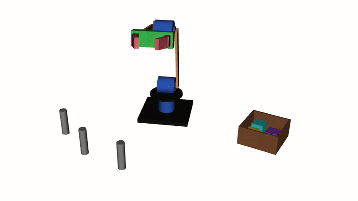

# ROS 2 Servo Arm: Pick and Place in RViz



A hobby learning project: a 3-DOF servo robot arm with a gripper, modelled from scratch in URDF and running a fully automatic pick-and-place sequence in RViz2 with ROS 2 Jazzy.

The arm picks three cubes from their posts, one by one, and drops them into a box. Then it returns home and repeats.

I built this to learn ROS 2 step by step, from the Linux terminal and package structure up to my own nodes, launch files and kinematics. The design is based on a hobby servo arm, so it can later drive real hardware.

## Features

- **Robot model in URDF**: base servo with turntable, shoulder and elbow servos, aluminium-style brackets, servo horns that rotate with their joints, and a V-shaped two-finger gripper
- **Mimic joint**: one command closes both fingers, like a gear-driven servo gripper
- **Inverse kinematics**: the node computes joint angles from a target position (cosine rule for the 2-link arm plus base rotation)
- **Automatic task sequence**: a step list (state machine) with smooth, servo-like motion
- **Scene with markers**: cubes, posts and box drawn on a `MarkerArray` topic, separate from the robot model
- **Attaching objects through TF**: a grasped cube is redrawn in the `palm` frame, so it follows the gripper automatically

## How it works

```
pick_place node ──joint angles──▶ /joint_states ──▶ robot_state_publisher ──▶ /tf ──▶ RViz2
       │                                              (reads arm.urdf)
       └──────cubes, posts, box──────▶ /pick_scene (MarkerArray) ──────────────────▶ RViz2
```

1. The node plans the job as a list of steps: move above the cube, go down, close the gripper, attach, lift, carry to the box, open, drop.
2. For every target position it uses inverse kinematics to get the joint angles.
3. Twenty times per second it publishes the current joint angles and redraws the scene.
4. robot_state_publisher combines the angles with the URDF and publishes the position of every part on `/tf`, which RViz uses to draw the arm.

## Limitations

This is a **kinematic simulation**: RViz has no physics, so the cubes are attached and released by the code rather than gripped through real contact.

## Author

Satish Hadkar, M.Sc. Sensor Systems Technology student at Hochschule Karlsruhe
